<p align="center">
  
</p>

<p align="center">
  <a href="https://www.pribinkbenny.com">
    
  </a>
</p>

<p align="center">
  <a href="https://www.pribinkbenny.com"></a>
  <a href="https://x.com/PRIBIN01"></a>
  <a href="https://www.instagram.com/pribin.k.benny"></a>
  
</p>


<table>
<tr>
<td width="58%" valign="top">

🤖 **AI & robotics engineer**, MSc AI & Robotics at the University of Hertfordshire (**Distinction**, 2025)

🏅 **Young Indian Achiever 2025**, recognised in the British Parliament for AI and robotics research

🦿 Building a **12-servo robot dog** end to end: inverse kinematics, evolved gaits, perception, fault detection

🧠 Shipping **LLM systems that are measured**, not just demoed: RAG with citations, agents, eval harnesses, QLoRA

🎓 **15+ Google ML/AI** certifications · **2 AWS Academy** certifications

</td>
<td width="42%" valign="top">

```yaml
pribin:
  focus:   [robotics, computer-vision, llm-systems]
  building: robot-dog (12x MG996R)
  stack:   [python, c++, pytorch, ros2]
  hardware: [jetson-nano, pca9685, servos]
  based:   Bengaluru, India
  open_to: [ml-engineer, robotics, embedded]
  motto:   "if it isn't measured, it isn't done"
```

</td>
</tr>
</table>


<p align="center">
  
</p>

<p align="center">
  
  
  
  
  
  
  
  
  
  
</p>


<p align="center">
  <a href="https://github.com/PRIBINKBENNY/13-gait-evolution">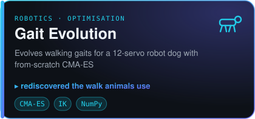</a>
  <a href="https://github.com/PRIBINKBENNY/12-telemetry-doctor">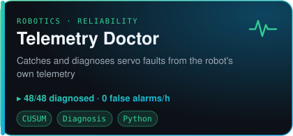</a>
</p>
<p align="center">
  <a href="https://github.com/PRIBINKBENNY/11-where-is-it">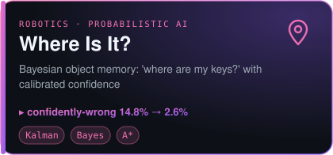</a>
  <a href="https://github.com/PRIBINKBENNY/05-quadruped">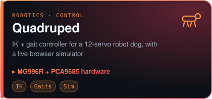</a>
</p>
<p align="center">
  <a href="https://github.com/PRIBINKBENNY/08-slam">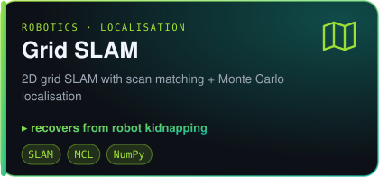</a>
  <a href="https://github.com/PRIBINKBENNY/10-sensor-fusion">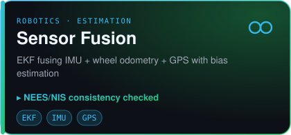</a>
</p>
<p align="center">
  <a href="https://github.com/PRIBINKBENNY/09-path-planning">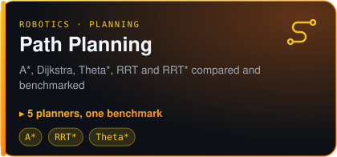</a>
  <a href="https://github.com/PRIBINKBENNY/06-vision">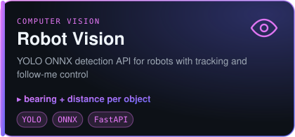</a>
</p>


<p align="center">
  <a href="https://github.com/PRIBINKBENNY/agent-hq">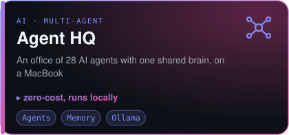</a>
  <a href="https://github.com/PRIBINKBENNY/01-rag">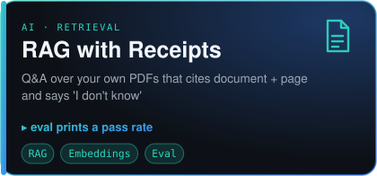</a>
</p>
<p align="center">
  <a href="https://github.com/PRIBINKBENNY/02-agents">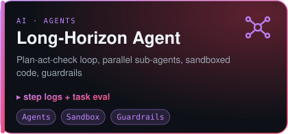</a>
  <a href="https://github.com/PRIBINKBENNY/07-llm-eval">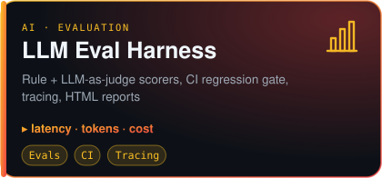</a>
</p>
<p align="center">
  <a href="https://github.com/PRIBINKBENNY/04-finetune">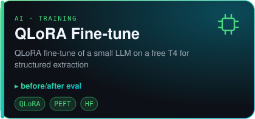</a>
  <a href="https://github.com/PRIBINKBENNY/03-deploy">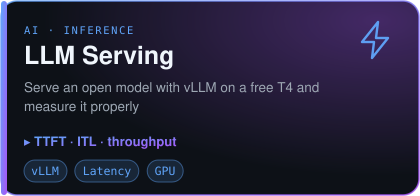</a>
</p>


<table>
<tr>
<td align="center" width="33%"><a href="https://github.com/PRIBINKBENNY/13-gait-evolution"></a><br/><sub><b>13-gait-evolution</b><br/>Evolved gait vs hand-written: support polygon + centre of mass</sub></td>
<td align="center" width="33%"><a href="https://github.com/PRIBINKBENNY/11-where-is-it"></a><br/><sub><b>11-where-is-it</b><br/>Robot memory: beliefs fade and reappear as objects move</sub></td>
<td align="center" width="33%"><a href="https://github.com/PRIBINKBENNY/08-slam"></a><br/><sub><b>08-slam</b><br/>Monte Carlo localisation recovering from a kidnap</sub></td>
</tr>
<tr>
<td align="center" width="33%"><a href="https://github.com/PRIBINKBENNY/10-sensor-fusion"></a><br/><sub><b>10-sensor-fusion</b><br/>EKF fusing IMU, odometry and GPS</sub></td>
<td align="center" width="33%"><a href="https://github.com/PRIBINKBENNY/09-path-planning"></a><br/><sub><b>09-path-planning</b><br/>RRT* growing and rewiring its tree</sub></td>
<td align="center" width="33%"><a href="https://github.com/PRIBINKBENNY/09-path-planning"></a><br/><sub><b>09-path-planning</b><br/>A* expanding the frontier</sub></td>
</tr>
</table>


<p align="center">
  
  
</p>

<p align="center">
  
</p>

<p align="center">
  <picture>
    <source media="(prefers-color-scheme: dark)" srcset="https://raw.githubusercontent.com/PRIBINKBENNY/PRIBINKBENNY/output/github-contribution-grid-snake-dark.svg" />
    
  </picture>
</p>

<p align="center">
  
</p>
